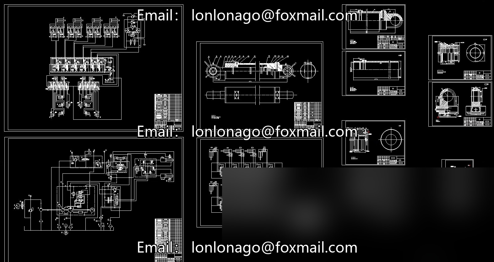
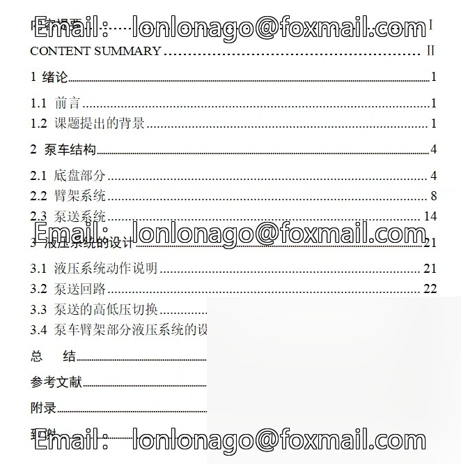

# Mixing pump truck hydraulic system design

## Body

Mixer pump truck hydraulic system design; concrete mixer pump truck hydraulic system design; mixer pump truck hydraulic system design diagram; mixer pump truck hydraulic system design CAD diagram
449 This document contains CAD diagrams and design manuals etc., for specific reference refer to the figures

This material includes design drawings, CAD figures and design descriptions; it also shows design appendices, design papers, content summaries, chapters, and describes the construction machinery as a versatile multi-purpose equipment with concrete transport, pumping and application functions, with hydraulic system design being of great significance for promoting pump vehicle development and the current project is SY5430JBC28 concrete mixing pump vehicle hydraulic system design.

<!-- AI_ENRICHED -->

## Images

## Payment

Here is a pay link on Stripe ( https://buy.stripe.com/3cs8yP7sY87d0vu9AB ). Please contact me lonlonago@foxmail.com after funding $89, and I will send you a complete data files , thank you!

